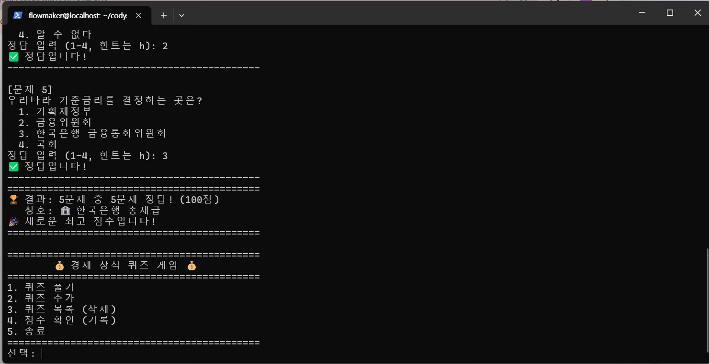
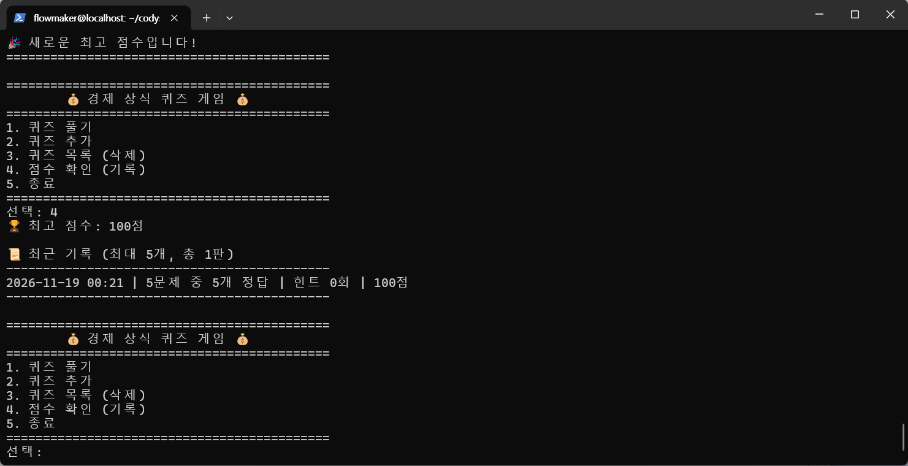

# 💰 경제 상식 퀴즈 게임

> Codyssey E1-2 「컴퓨터에게 명령 내리는 말(파이썬) 처음 배우기」 미션 결과물

## 1. 프로젝트 개요

터미널(콘솔)에서 동작하는 **4지선다 경제 상식 퀴즈 게임**입니다.

- 메뉴에서 번호를 골라 **퀴즈 풀기 / 퀴즈 추가 / 퀴즈 목록 / 점수 확인 / 종료**를 할 수 있습니다.
- 퀴즈와 최고 점수, 게임 기록은 프로젝트 루트의 `state.json`에 저장되어 **프로그램을 껐다 켜도 유지**됩니다.
- `Quiz`(문제 한 개)와 `QuizGame`(게임 전체) **두 클래스**로 역할을 나눴습니다.
- 외부 라이브러리 없이 **Python 표준 라이브러리만** 사용했습니다. (`json`, `os`, `random`, `datetime`)

## 2. 퀴즈 주제와 선정 이유

**주제: 경제 상식 (수요·공급, 기회비용, 인플레이션, 금리, GDP, 탄력성, 한계효용)**

- 저는 경제학을 전공하고 있어서, 수업에서 배운 개념을 문제로 만들면 **정답과 해설을 정확하게** 쓸 수 있습니다.
- 뉴스에 자주 나오는 단어(기준금리, 인플레이션, 스태그플레이션)라서 **누가 풀어도 쓸모 있는 상식**이 됩니다.
- 직접 문제를 만들면서 개념을 한 번 더 복습하는 효과도 있었습니다.

## 3. 실행 방법

```bash
# Python 3.10 이상 필요
python3 --version

# 프로젝트 폴더에서 실행
python3 main.py
```

- 처음 실행하면 기본 경제 퀴즈 8개로 시작하고, `state.json`이 자동으로 만들어집니다.
- 메뉴에서 `1`~`5`를 입력해 기능을 고릅니다. 종료는 `5` (또는 `Ctrl+C`도 안전하게 저장 후 종료).

## 4. 기능 목록

| 메뉴 | 기능 | 설명 |
|---|---|---|
| 1 | 퀴즈 풀기 | 풀 문제 수를 고르면 **랜덤 순서**로 출제, 정답/오답 즉시 안내, 마지막에 점수·칭호 표시 |
| 2 | 퀴즈 추가 | 문제, 선택지 4개, 정답 번호(1-4), 힌트(선택)를 입력해 새 퀴즈 등록 → 파일 저장 |
| 3 | 퀴즈 목록 | 등록된 퀴즈 목록 표시, 원하면 번호로 **삭제** (0 = 돌아가기) → 파일 저장 |
| 4 | 점수 확인 | 최고 점수 + **최근 게임 기록** (날짜/시간, 문제 수, 정답 수, 힌트 사용, 점수) |
| 5 | 종료 | 데이터 저장 후 종료 |

**입력/예외 처리**

- 모든 숫자 입력은 앞뒤 공백을 지우고(`" 1 "` → `1`) 처리합니다.
- 빈 입력, 숫자가 아닌 입력(`abc`), 범위 밖 숫자(메뉴 `9`, 정답 `0`) → 안내 메시지 후 다시 입력받습니다.
- `Ctrl+C`(KeyboardInterrupt), 입력 끝(EOFError) → 안내 메시지 출력, 저장 후 안전하게 종료합니다.
- `state.json`이 없으면 기본 퀴즈로 시작, 손상되었으면 안내 후 기본 데이터로 복구합니다.

**보너스 기능**

- 랜덤 출제 (`random.sample`) / 문제 수 선택
- 힌트: 문제 풀 때 `h` 입력 → 힌트 표시, 힌트 1회당 **-5점**
- 퀴즈 삭제 (3번 메뉴에서)
- 점수 기록 히스토리 (모든 게임 기록을 `state.json`의 `history`에 저장)
- 점수별 칭호: 100점 🏦 한국은행 총재급, 80점↑ 📈 애널리스트급, 60점↑ 📰 경제신문 애독자 …

## 5. 파일 구조

```
codyssey-e1-2-quiz/
├── main.py              # 실행 시작점: QuizGame 을 만들고 run() 호출
├── quiz_game.py         # QuizGame 클래스: 메뉴, 풀기/추가/목록/점수, 입력 처리, 파일 저장/불러오기
├── quiz.py              # Quiz 클래스: 문제 1개(문제/선택지/정답/힌트), 출력·정답 확인·dict 변환
├── default_quizzes.py   # 기본 경제 퀴즈 8개 (파일이 없거나 손상됐을 때 사용)
├── state.json           # 실행하면 자동 생성되는 데이터 파일 (.gitignore 로 Git 에서는 제외)
├── .gitignore
├── README.md
└── docs/
    └── screenshots/     # 실행 화면 캡처 (menu / play / add_quiz / score)
```

## 6. 데이터 파일 설명 (`state.json`)

- **경로**: 프로젝트 루트 (`main.py`와 같은 폴더)의 `state.json`
- **역할**: 퀴즈 목록, 최고 점수, 게임 기록을 저장해서 프로그램을 다시 켜도 데이터가 유지되게 함
- **인코딩**: UTF-8 (`ensure_ascii=False`로 한글이 그대로 저장됨)
- **언제 저장?**: 퀴즈 풀기 끝, 퀴즈 추가/삭제, 종료, `Ctrl+C` 종료 시
- **Git 에서 제외한 이유**: 실행할 때마다 바뀌는 개인 기록이라서 `.gitignore`에 넣었습니다. 처음 실행하면 자동으로 생깁니다.

**스키마(필드 구조)**

| 키 | 타입 | 설명 |
|---|---|---|
| `quizzes` | list | 퀴즈 목록 |
| `quizzes[].question` | str | 문제 |
| `quizzes[].choices` | list[str] (4개) | 선택지 |
| `quizzes[].answer` | int (1~4) | 정답 번호 |
| `quizzes[].hint` | str | 힌트 (없으면 `""`) |
| `best_score` | int 또는 null | 최고 점수(0~100). 아직 안 풀었으면 `null` |
| `history` | list | 게임 기록 |
| `history[].played_at` | str | 플레이 날짜/시간 (`YYYY-MM-DD HH:MM`) |
| `history[].total` / `correct` | int | 푼 문제 수 / 맞힌 수 |
| `history[].hints_used` | int | 힌트 사용 횟수 |
| `history[].score` | int | 최종 점수 (힌트 차감 후) |

**예시**

```json
{
  "quizzes": [
    {
      "question": "물가가 전반적으로, 지속적으로 오르는 현상은?",
      "choices": ["디플레이션", "인플레이션", "스태그네이션", "리세션"],
      "answer": 2,
      "hint": "'인플레'라고 줄여 말하기도 해요."
    }
  ],
  "best_score": 80,
  "history": [
    {"played_at": "2026-11-18 21:05", "total": 5, "correct": 4, "hints_used": 0, "score": 80}
  ]
}
```

## 7. 실행 화면

| 메뉴 | 퀴즈 풀기 |
|---|---|
|  |  |

| 퀴즈 추가 | 점수 확인 |
|---|---|
|  |  |

## 8. Git 작업 기록

- 기능 단위 커밋 (`Feat:` / `Fix:` / `Docs:` / `Refactor:`)
- `feature/play` 브랜치에서 퀴즈 풀기 기능 개발 후 `main`에 병합
- 저장소를 다른 폴더에 `clone` → 수정 후 `push` → 원래 폴더에서 `pull` 실습
