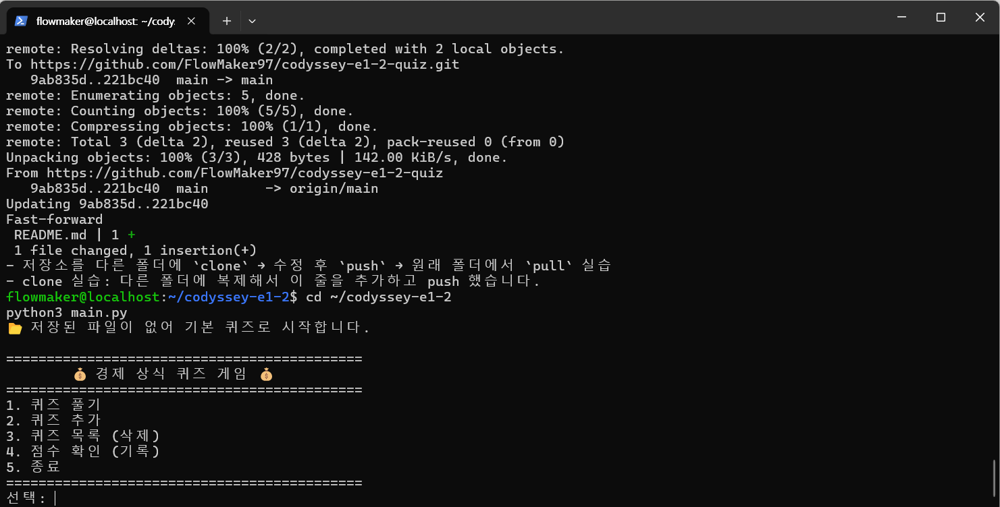
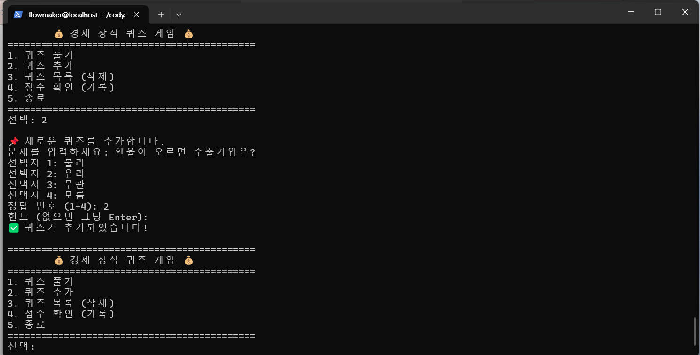

# 💰 경제 상식 퀴즈 게임

> Codyssey E1-2 「컴퓨터에게 명령 내리는 말(파이썬) 처음 배우기」 미션 결과물

## 1. 프로젝트 개요

터미널(콘솔)에서 동작하는 **4지선다 경제 상식 퀴즈 게임**입니다.

- 메뉴에서 번호를 골라 **퀴즈 풀기 / 퀴즈 추가 / 퀴즈 목록 / 점수 확인 / 종료**를 할 수 있습니다.
- 퀴즈와 최고 점수, 게임 기록은 프로젝트 루트의 `state.json`에 저장되어 **프로그램을 껐다 켜도 유지**됩니다.
- `Quiz`(문제 한 개)와 `QuizGame`(게임 전체) **두 클래스**로 역할을 나눴습니다.
- 외부 라이브러리 없이 **Python 표준 라이브러리만** 사용했습니다. (`json`, `os`, `random`, `datetime`)

## 2. 퀴즈 주제와 선정 이유

**주제: 경제 상식 (수요·공급, 기회비용, 인플레이션, 금리, GDP, 탄력성, 한계효용)**

- 저는 경제학을 전공하고 있어서, 수업에서 배운 개념을 문제로 만들면 **정답과 해설을 정확하게** 쓸 수 있습니다.
- 뉴스에 자주 나오는 단어(기준금리, 인플레이션, 스태그플레이션)라서 **누가 풀어도 쓸모 있는 상식**이 됩니다.
- 직접 문제를 만들면서 개념을 한 번 더 복습하는 효과도 있었습니다.

## 3. 실행 방법

```bash
# Python 3.10 이상 필요
python3 --version

# 프로젝트 폴더에서 실행
python3 main.py
```

- 처음 실행하면 기본 경제 퀴즈 8개로 시작하고, `state.json`이 자동으로 만들어집니다.
- 메뉴에서 `1`~`5`를 입력해 기능을 고릅니다. 종료는 `5` (또는 `Ctrl+C`도 안전하게 저장 후 종료).

## 4. 기능 목록

| 메뉴 | 기능 | 설명 |
|---|---|---|
| 1 | 퀴즈 풀기 | 풀 문제 수를 고르면 **랜덤 순서**로 출제, 정답/오답 즉시 안내, 마지막에 점수·칭호 표시 |
| 2 | 퀴즈 추가 | 문제, 선택지 4개, 정답 번호(1-4), 힌트(선택)를 입력해 새 퀴즈 등록 → 파일 저장 |
| 3 | 퀴즈 목록 | 등록된 퀴즈 목록 표시, 원하면 번호로 **삭제** (0 = 돌아가기) → 파일 저장 |
| 4 | 점수 확인 | 최고 점수 + **최근 게임 기록** (날짜/시간, 문제 수, 정답 수, 힌트 사용, 점수) |
| 5 | 종료 | 데이터 저장 후 종료 |

**입력/예외 처리**

- 모든 숫자 입력은 앞뒤 공백을 지우고(`" 1 "` → `1`) 처리합니다.
- 빈 입력, 숫자가 아닌 입력(`abc`), 범위 밖 숫자(메뉴 `9`, 정답 `0`) → 안내 메시지 후 다시 입력받습니다.
- `Ctrl+C`(KeyboardInterrupt), 입력 끝(EOFError) → 안내 메시지 출력, 저장 후 안전하게 종료합니다.
- `state.json`이 없으면 기본 퀴즈로 시작, 손상되었으면 안내 후 기본 데이터로 복구합니다.

**보너스 기능**

- 랜덤 출제 (`random.sample`) / 문제 수 선택
- 힌트: 문제 풀 때 `h` 입력 → 힌트 표시, 힌트 1회당 **-5점**
- 퀴즈 삭제 (3번 메뉴에서)
- 점수 기록 히스토리 (모든 게임 기록을 `state.json`의 `history`에 저장)
- 점수별 칭호: 100점 🏦 한국은행 총재급, 80점↑ 📈 애널리스트급, 60점↑ 📰 경제신문 애독자 …

## 5. 파일 구조

```
codyssey-e1-2-quiz/
├── main.py              # 실행 시작점: QuizGame 을 만들고 run() 호출
├── quiz_game.py         # QuizGame 클래스: 메뉴, 풀기/추가/목록/점수, 입력 처리, 파일 저장/불러오기
├── quiz.py              # Quiz 클래스: 문제 1개(문제/선택지/정답/힌트), 출력·정답 확인·dict 변환
├── default_quizzes.py   # 기본 경제 퀴즈 8개 (파일이 없거나 손상됐을 때 사용)
├── state.json           # 실행하면 자동 생성되는 데이터 파일 (.gitignore 로 Git 에서는 제외)
├── .gitignore
├── README.md
└── docs/
    └── screenshots/     # 실행 화면 캡처 (menu / play / add_quiz / score)
```

## 6. 데이터 파일 설명 (`state.json`)

- **경로**: 프로젝트 루트 (`main.py`와 같은 폴더)의 `state.json`
- **역할**: 퀴즈 목록, 최고 점수, 게임 기록을 저장해서 프로그램을 다시 켜도 데이터가 유지되게 함
- **인코딩**: UTF-8 (`ensure_ascii=False`로 한글이 그대로 저장됨)
- **언제 저장?**: 퀴즈 풀기 끝, 퀴즈 추가/삭제, 종료, `Ctrl+C` 종료 시
- **Git 에서 제외한 이유**: 실행할 때마다 바뀌는 개인 기록이라서 `.gitignore`에 넣었습니다. 처음 실행하면 자동으로 생깁니다.

**스키마(필드 구조)**

| 키 | 타입 | 설명 |
|---|---|---|
| `quizzes` | list | 퀴즈 목록 |
| `quizzes[].question` | str | 문제 |
| `quizzes[].choices` | list[str] (4개) | 선택지 |
| `quizzes[].answer` | int (1~4) | 정답 번호 |
| `quizzes[].hint` | str | 힌트 (없으면 `""`) |
| `best_score` | int 또는 null | 최고 점수(0~100). 아직 안 풀었으면 `null` |
| `history` | list | 게임 기록 |
| `history[].played_at` | str | 플레이 날짜/시간 (`YYYY-MM-DD HH:MM`) |
| `history[].total` / `correct` | int | 푼 문제 수 / 맞힌 수 |
| `history[].hints_used` | int | 힌트 사용 횟수 |
| `history[].score` | int | 최종 점수 (힌트 차감 후) |

**예시**

```json
{
  "quizzes": [
    {
      "question": "물가가 전반적으로, 지속적으로 오르는 현상은?",
      "choices": ["디플레이션", "인플레이션", "스태그네이션", "리세션"],
      "answer": 2,
      "hint": "'인플레'라고 줄여 말하기도 해요."
    }
  ],
  "best_score": 80,
  "history": [
    {"played_at": "2026-11-18 21:05", "total": 5, "correct": 4, "hints_used": 0, "score": 80}
  ]
}
```

## 7. 실행 화면

| 메뉴 | 퀴즈 풀기 |
|---|---|
|  |  |

| 퀴즈 추가 | 점수 확인 |
|---|---|
|  |  |

## 8. Git 작업 기록

- **원격 저장소**: https://github.com/FlowMaker97/codyssey-e1-2-quiz
- **커밋 규칙**: 기능 하나당 커밋 하나, 메시지 앞에 `Feat:` / `Fix:` / `Docs:` / `Refactor:` / `Merge:` 를 붙임
- **총 커밋 수**: 16개 (이 문서 보강 전 기준, 아래 로그)

### 8-1. 커밋 로그 (`git log --oneline --graph --all` 실제 출력)

```text
* 457be13 Docs: 실행 화면 스크린샷 추가 (메뉴, 풀기, 추가, 점수)
* bf9d04d Fix: 한글 입력 깨짐(서로게이트 문자)으로 저장 중 비정상 종료되는 오류 수정
* 221bc40 Docs: clone 실습 - 복제 저장소에서 README 한 줄 추가
* 9ab835d Docs: README 작성 (개요, 주제 선정 이유, 실행 방법, 기능, 파일 구조, state.json)
* 62f2c93 Feat: 랜덤 출제, 문제 수 선택, 힌트(-5점), 퀴즈 삭제, 점수 기록 히스토리 추가
* ca74b51 Refactor: QuizGame 클래스를 quiz_game.py 로 분리하고 main.py 는 실행만 담당
* f4fa6f9 Feat: state.json 저장/불러오기 및 손상 파일 복구 처리
* 01d729a Feat: 최고 점수 확인 및 갱신 기능 구현
* 27929db Feat: 퀴즈 목록 보기 기능 구현 (퀴즈 없음 처리 포함)
* b01099b Feat: 퀴즈 추가 기능 구현 (문제/선택지 4개/정답 입력 검증)
*   73f423a Merge: feature/play 브랜치 병합 (퀴즈 풀기 기능)
|\
| * 759c742 Feat: 퀴즈 풀기 기능 구현 (출제, 정답 확인, 결과 표시)
|/
* d6aebf5 Feat: 경제 상식 기본 퀴즈 8개를 Quiz 인스턴스로 추가
* 264f2a1 Feat: Quiz 클래스 구현 (문제 출력, 정답 확인, dict 변환)
* de1fe41 Feat: 메인 메뉴 출력 및 숫자 입력 검증(get_number) 구현
* 7d54453 Feat: 프로젝트 초기 설정 (.gitignore, README, main.py)
```

### 8-2. 사용한 Git 명령

| 명령 | 사용한 곳 |
|---|---|
| `git init` | 프로젝트 시작 (`7d54453`) |
| `git add` / `git commit` | 모든 기능 커밋 |
| `git push` | 커밋마다 GitHub 원격 저장소에 업로드 |
| `git checkout -b feature/play` | 퀴즈 풀기 기능용 브랜치 생성 (`759c742`) |
| `git checkout main` + `git merge feature/play` | main 으로 돌아와 병합 (`73f423a`) |
| `git clone` | 다른 폴더에 저장소 복제 (`221bc40`) |
| `git pull` | 원래 폴더에서 복제본의 변경 내려받기 |

### 8-3. clone / pull 실습 과정

```bash
# 1) 다른 폴더에 저장소 복제
git clone https://github.com/FlowMaker97/codyssey-e1-2-quiz.git ~/clone-test-e1-2
cd ~/clone-test-e1-2

# 2) 복제본에서 README 한 줄 추가 후 커밋, push
echo "- clone 실습: 다른 폴더에 복제해서 이 줄을 추가하고 push 했습니다." >> README.md
git add README.md && git commit -m "Docs: clone 실습 - 복제 저장소에서 README 한 줄 추가" && git push

# 3) 원래 작업 폴더로 돌아와 pull 로 변경 받기
cd ~/codyssey-e1-2 && git pull && tail -n 2 README.md
```

- 결과: 복제본에서 만든 커밋 `221bc40` 이 원격에 올라갔고, 원래 폴더에서 `git pull` 후 같은 커밋이 로그에 나타났습니다. (위 8-1 로그의 `221bc40`)
- 이 README 아래쪽의 `clone 실습: 다른 폴더에 복제해서 이 줄을 추가하고 push 했습니다.` 문장이 그때 복제본에서 추가한 줄입니다.

### 8-4. 브랜치를 나눈 이유와 병합의 의미

- **나눈 이유 (위험 격리)**: 퀴즈 풀기는 게임의 핵심이라 만드는 도중 코드가 자주 깨집니다. `main` 은 항상 실행되는 상태로 두고, 미완성 코드는 `feature/play` 에서만 작업해 실패해도 `main` 에 영향이 없게 했습니다.
- **병합의 의미 (통합)**: 기능이 완성·확인된 뒤에 `main` 에 합쳐서 "검증된 기능만 본 줄기에 들어간다"는 흐름을 만들었습니다. 그래프의 갈라졌다 합쳐지는 선(`73f423a`)이 그 기록입니다.
- 여러 명이 동시에 작업할 때도 각자 브랜치에서 작업 후 병합하면 서로의 코드를 덮어쓰지 않습니다.

## 9. 설계 설명

### 9-1. 객체지향(클래스)으로 만든 이유

| 클래스 | 책임 | 주요 메서드 |
|---|---|---|
| `Quiz` | 문제 한 개의 데이터와 동작 | `display`, `is_correct`, `to_dict`, `from_dict` |
| `QuizGame` | 게임 전체 진행, 입력 검증, 저장 | `run`, `play_quiz`, `add_quiz`, `get_number`, `load_state`, `save_state` |

- **캡슐화**: 문제 데이터(질문·선택지·정답)와 그 데이터를 다루는 동작(정답 확인, dict 변환)을 `Quiz` 한 곳에 묶었습니다. 정답 판정 방식을 바꿔도 `Quiz` 만 고치면 됩니다.
- **재사용**: 기본 퀴즈, 사용자가 추가한 퀴즈, 파일에서 불러온 퀴즈 모두 같은 `Quiz` 객체로 다룹니다.
- **함수만 쓸 때와 비교**: 함수만으로 만들면 퀴즈 목록·최고 점수 같은 상태를 전역 변수나 매개변수로 계속 넘겨야 해서 코드가 길어지고 실수하기 쉽습니다. 클래스는 상태를 `self` 안에 들고 다녀서 이 문제가 줄어듭니다. 대신 작은 스크립트에서는 클래스가 오히려 코드량을 늘릴 수 있다는 단점이 있습니다.

### 9-2. state.json 을 이렇게 설계한 이유

- **`quizzes` 를 객체의 리스트로 둔 이유**: 퀴즈는 여러 개이고 개수가 계속 바뀌므로 리스트가 자연스럽습니다. 각 퀴즈는 질문·선택지·정답·힌트가 한 묶음이라 객체(dict)로 두면 `Quiz.from_dict` 로 바로 복원됩니다.
- **`history` 를 리스트로 둔 이유**: 게임을 할 때마다 기록이 하나씩 쌓이는 구조라서, 뒤에 추가(append)하기 쉬운 리스트를 썼습니다. 나중에 "평균 점수", "최근 5회" 같은 통계를 계산하기도 쉽습니다.
- **확장성**: 새 필드(예: 난이도)를 추가해도 기존 키는 그대로라서 예전 파일도 읽을 수 있습니다. 실제로 `history` 가 없는 예전 파일도 `data.get("history", [])` 로 문제없이 읽습니다.

### 9-3. JSON 저장 방식의 한계

- **전체 읽기/전체 쓰기**: 저장할 때마다 파일 전체를 다시 씁니다. 퀴즈가 수만 개로 늘면 저장 시간이 길어지고, 불러올 때 모든 데이터를 메모리에 한꺼번에 올려야 합니다.
- **동시 접근에 약함**: 여러 프로그램이 동시에 쓰면 한쪽 내용이 덮어써질 수 있습니다.
- **검색이 느림**: 특정 퀴즈만 찾으려 해도 전체를 읽어야 합니다.
- **그래도 선택한 이유**: 이 게임은 데이터가 수십 개 수준이라 위 한계가 문제되지 않고, 사람이 바로 읽고 고칠 수 있으며, 파이썬 기본 `json` 모듈만으로 처리됩니다. 데이터가 커지면 SQLite 같은 데이터베이스로 옮기는 것이 맞습니다.

### 9-4. 백업과 복구 정책

| 상황 | 동작 |
|---|---|
| 파일 없음 | 기본 퀴즈 8개로 시작, 종료 시 새로 생성 |
| 저장할 때 | 기존 `state.json` 을 `state.json.bak` 으로 복사한 뒤, 임시 파일(`.tmp`)에 먼저 쓰고 `os.replace` 로 한 번에 교체 (저장 도중 꺼져도 파일이 반쯤 깨지지 않음) |
| 파일 손상 (JSON 깨짐, 타입 오류) | 손상 원본을 `state.json.corrupt` 로 옮겨 보관 → 기본 데이터로 복구 → 새로 저장 |
| 직전 상태로 되돌리고 싶을 때 | `cp state.json.bak state.json` 후 다시 실행 |
| 완전히 초기화하고 싶을 때 | `rm state.json` 후 다시 실행하면 기본 퀴즈로 시작 |
| 읽기 권한 오류 등 | 안내 메시지 출력 후 기본 퀴즈로 시작 (기존 파일은 건드리지 않음) |

백업 파일(`.bak`, `.corrupt`, `.tmp`)은 개인 실행 기록이라 `.gitignore` 에 넣었습니다.

### 9-5. 요구사항이 바뀌면 고칠 곳

| 바뀌는 요구 | 먼저 고칠 파일 / 메서드 |
|---|---|
| 문제 형식 (예: 주관식, 선택지 5개) | `quiz.py` 의 `Quiz` → `QuizGame.add_quiz`, `get_answer` |
| 점수 계산 방식 | `QuizGame.play_quiz`, `update_best_score` |
| 저장 형식/위치 | `QuizGame.load_state`, `save_state`, `STATE_FILE` |
| 메뉴 추가 | `QuizGame.show_menu`, `run` |
| 기본 문제 변경 | `default_quizzes.py` |

---

- clone 실습: 다른 폴더에 복제해서 이 줄을 추가하고 push 했습니다.
